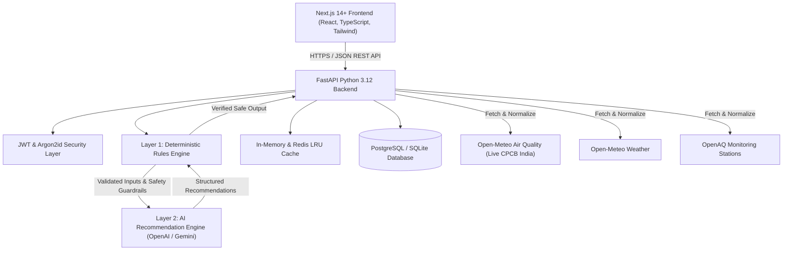

# System Architecture & Technical Specification
## Urban Air AI

---

## 1. Frontend Architecture
- **Framework:** Next.js (App Router), React 18/19, TypeScript strict mode.
- **Styling & UI:** Tailwind CSS, Radix UI accessible primitives, Lucide React icons.
- **Data Visualization:** Recharts for 24h, 7d, and 30d AQI trends, pollutant sub-indices, and travel carbon savings.
- **State Management & Data Fetching:** Custom React hooks with SWR-style caching, optimistic updates, and offline fallback state.
- **Accessibility:** Semantic landmarks (`main`, `nav`, `section`, `article`), ARIA live regions for air quality alerts, keyboard focus rings (`focus-visible:ring-2`), minimum contrast ratio > 4.5:1.

---

## 2. Backend Architecture
- **Framework:** FastAPI with Python 3.12, ASGI architecture.
- **ORM & Database:** SQLAlchemy 2.0 with declarative mapped types, indexing on user IDs, location coordinates, and timestamps.
- **Validation:** Pydantic v2 schemas for strict input/output verification.
- **Security:** Argon2id / bcrypt password hashing, HTTP-only secure cookie support, rate limiting middleware, CORS whitelist.
- **Modular Layout:**
  - `app/api/v1/`: Endpoint routers for auth, users, locations, air-quality, weather, plans, indoor, family, routes, impact, assistant, notifications, reports, settings.
  - `app/core/`: Application settings, security, database session, custom exceptions.
  - `app/models/`: SQLAlchemy ORM models.
  - `app/schemas/`: Pydantic request/response schemas.
  - `app/services/`: Business logic orchestration.
  - `app/repositories/`: Database abstraction.
  - `app/rules/`: Deterministic CPCB NAQI calculation, exposure thresholds, ventilation matrices, and plan validators.
  - `app/integrations/`: Resilient HTTP clients for Open-Meteo Air Quality, Weather, and OpenAQ.

---

## 3. Two-Layer AI Safety Architecture
To ensure zero hallucinations, zero medical malpractice risks, and deterministic safety:
1. **Layer 1: Deterministic Environmental Rules Engine**
   - Applies official CPCB NAQI breakpoints.
   - Evaluates data freshness (Fresh <2h, Delayed 2-6h, Stale >6h).
   - Enforces hard safety boundaries (e.g. if AQI > 300, outdoor strenuous exercise is strictly disallowed; alternatives to indoor workout are enforced).
   - Validates all AI outputs against physical plausibility and safety guidelines.
2. **Layer 2: AI Personalization Engine**
   - Contextualizes recommendations to the user's specific schedule, family composition, and commute habits.
   - Produces strictly validated JSON matching Pydantic schemas.
   - Includes graceful deterministic fallback if the AI provider times out or returns malformed data.
